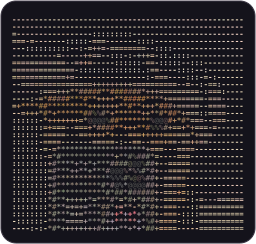

  

  

 

---

# 🎓 About Me

🎓 <em>✏️ A sentence about you and what you do.</em>
🔐 <em>✏️ A sentence about you and what you do.</em>
💡 <em>✏️ A sentence about you and what you do.</em>

---

# 🚀 Projects

* 🤖 **Jarvis AI Assistant**
* 💻 <em>✏️ What you built and why it matters.</em>
* 👁️ <em>✏️ What you built and why it matters.</em>
* 🎬 **Movie Analysis Project**

---

# 🌐 Connect With Me

---

# 💻 Tech Stack:
              

